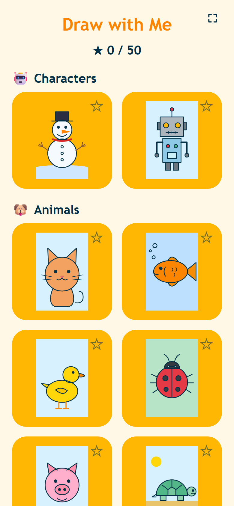
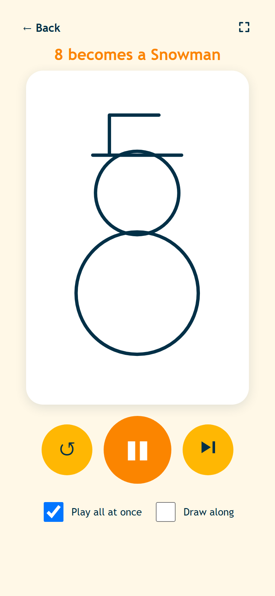
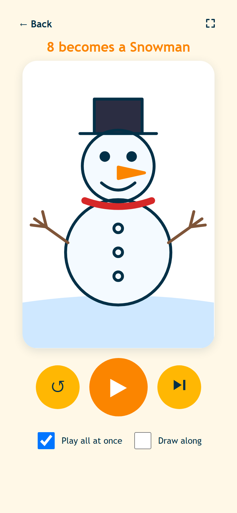

# Draw with Me

An offline-first progressive web app (PWA) with 50 narrated drawing lessons for kids aged 5-8. Each lesson shows how to draw an animal, vehicle or other object, starting from a geometric shape, number or letter. Lessons are animated SVG drawings, not video, and are described in JSON. Each step has start and end times, and the picture is calculated from the audio's current time, so voice and drawing always stay in sync.

Kids can step through one stage at a time (the default), play the whole lesson, replay, or draw along on a blank pad. The app works offline once loaded and can be installed to the Home Screen. It has no backend and collects no user data.

**Live demo:** https://draw-with-me.dianapilat89.workers.dev/

|             Home              |           Lesson mid-draw            |            Lesson finished            |
| :---------------------------: | :----------------------------------: | :-----------------------------------: |
|  |  |  |

## Tech stack

- **React 19 + TypeScript (strict)** with custom CSS, built with **Vite**.
- **Lessons as data:** each lesson is a JSON file of SVG paths and step timings. Adding a lesson needs no code changes.
- **Playback:** the `<audio>` element's clock drives the animation (a timer is used for lessons without audio). The canvas is a pure function of the current time, so seeking, replay and step mode need no animation state.
- **Offline / PWA:** a Workbox service worker (via `vite-plugin-pwa`) precaches the app, lesson data and audio. Routing uses `HashRouter`, which works offline on static hosting.
- **Narration:** generated locally with Piper text-to-speech and ffmpeg (m4a, which iPhone requires).
- **Draw-along:** a blank pad built on Pointer Events, so touch, stylus and mouse share one implementation.
- **Progress:** completed lessons are kept in `localStorage` on the device.
- **Hosting:** Cloudflare, deployed from the `main` branch on GitHub.
- **Quality checks:** ESLint (typescript-eslint, React hooks rules) and Prettier, with a Playwright smoke test of the main player flow (see below). GitHub Actions runs lint, format check, build and the smoke test on every push and pull request. Manually tested on desktop, Kindle and iPhone.

## Design decisions

**Animated SVG instead of video.** A lesson is a list of paths, so it is a few KB of JSON instead of megabytes of video, stays sharp at any screen size, and can be seeked to any point instantly. The cost is that each lesson has to be authored as vector paths rather than recorded.

**The canvas is a pure function of time.** `LessonCanvas` takes the current time and works out how much of every path to show, with no animation state of its own. Seeking, replay, step mode and pausing then need no extra bookkeeping, and the picture cannot drift out of sync with the audio. All timing lives in one place, `useLessonPlayer`.

**The audio element is the clock.** When a lesson has narration, `audio.currentTime` drives playback, so the drawing follows the voice even if the audio stalls or buffers. Lessons without audio fall back to a `requestAnimationFrame` timer.

**Step mode by default.** The player pauses at the end of each step (`pauseAt`), so a child can draw each stage before moving on. "Play all at once" turns it off.

**Lessons are data, not code.** Adding a lesson means adding a JSON file and an entry in `index.json`. That is how the library grew to 50 lessons without code changes.

**Service worker for offline, `localStorage` for progress.** Content is fixed files, which a Workbox service worker precaches. The only user data is the list of finished lessons, which is small enough for `localStorage` (read defensively, since storage can be blocked). IndexedDB would add complexity without a use for it.

**`HashRouter`.** URLs like `/#/lesson/01` work offline and on static hosting without server rewrite rules.

**Local text-to-speech.** Narration is generated with Piper (free, offline, consistent voice) and placed on the timeline by a script, so re-recording a lesson after a text change is one command.

**One input path for draw-along.** The pad uses Pointer Events, so touch, stylus and mouse behave the same.

### Trade-offs and what I would change at scale

- The service worker precaches every lesson and audio file (about 9 MB). That is fine for 50 lessons, but a larger library should cache lessons on demand or per category.
- Progress lives only on one device. Syncing across devices would need accounts and a backend, which this app deliberately avoids.
- Lesson paths are written by hand or by script. A larger library needs an authoring tool or import pipeline (see "Planned tooling").
- Test coverage is one end-to-end smoke test. The timeline logic in `useLessonPlayer` is the first place to add unit tests.
- ESLint runs against TypeScript 6 and the build against TypeScript 7 (see "Linting and TypeScript versions").

## Status

| Milestone                                                              | State                           |
| ---------------------------------------------------------------------- | ------------------------------- |
| 1. Installable offline shell (React, Vite, Workbox)                    | Done                            |
| 2. Lesson engine: stroke animation, player controls, one sample lesson | Done                            |
| 3. Five sample lessons with Piper voice-over                           | Done                            |
| 4. Home screen with categories and progress stars                      | Done                            |
| 5. Remaining lessons (50 total)                                        | Done                            |
| 6. iPhone polish, optional draw-along canvas                           | Done (tested on iPhone, Kindle) |
| 7. Deploy to a static HTTPS host                                       | Done                            |

All 50 lessons have a voice-over (Piper, en_GB-alba-medium) as an m4a file, and playback follows the audio clock.

## Requirements

- Node.js 20 or newer (developed on 22)
- npm

## Commands

```bash
npm install
npm run dev        # dev server (service worker is not active in dev)
npm run build      # type-check and production build into dist/
npm run preview    # serve dist/ at http://localhost:4173
```

`npm install` may need `--legacy-peer-deps` because of a Babel peer-dependency conflict between `@vitejs/plugin-react` and `vite-plugin-pwa`.

### Linting and formatting

```bash
npm run lint           # ESLint
npm run format:check   # Prettier (use `npm run format` to fix)
npm run check          # lint + format check + type-check/build
```

### Linting and TypeScript versions

`typescript-eslint` does not support TypeScript 7 yet, so `package.json` follows the side-by-side setup from the TypeScript 7 announcement: the `typescript` package is aliased to `@typescript/typescript6` (used by ESLint), and TypeScript 7 is installed as `@typescript/native`, which provides the `tsc` that `npm run build` runs. The alias can be removed once typescript-eslint supports TS 7.

### Smoke test

With `npm run preview` running in one terminal:

```bash
npx playwright install chromium   # first time only
node tools/check-player.mjs <output-folder>
```

It plays lesson 01 at iPhone size, checks step-by-step mode, reloads offline, and saves `mid.png` and `final.png` screenshots to the folder. It takes about a minute and exits with a non-zero code if any check fails, which is how CI uses it.

### Generating a voice-over

Needs Piper (a Python venv with `piper-tts`), the voice model files in one folder, and ffmpeg for m4a output:

```bash
node tools/make-voice.mjs 01 [--piper-env DIR] [--voices DIR] [--voice NAME]
```

Defaults: `~/piper-env`, `~/piper-voices`, `en_GB-alba-medium`. Set `FFMPEG` to the ffmpeg binary if it is not on PATH; without ffmpeg a .wav is written instead. The script renders each step's narration, places it at the step start, lengthens any step shorter than its narration (plus 0.7 s), rewrites the lesson's `start`/`end` times and sets `audio`. Re-run it after editing narration.

### Regenerating icons

```bash
node tools/make-icons.mjs
```

Renders `public/icon.svg` into `icon-192.png`, `icon-512.png` and `apple-touch-icon.png`.

## How lessons work

A lesson is a JSON file in `public/lessons/` (for example `01.json`), listed in `public/lessons/index.json`. A lesson has steps, and each step has narration text, a start and end time in seconds, and a list of SVG paths:

```json
{
  "id": "01",
  "title": "8 becomes a Snowman",
  "category": "Characters",
  "viewBox": "0 0 400 600",
  "audio": "01.m4a",
  "steps": [
    {
      "narration": "Let's draw a big number 8!",
      "start": 0,
      "end": 8,
      "paths": [
        {
          "d": "M125 220a75 75 0 1 0 150 0a75 75 0 1 0 -150 0",
          "stroke": "#023047"
        }
      ]
    }
  ]
}
```

- **Paths with `stroke`** are drawn on, one after another, sharing the step's time equally. Optional `width` defaults to 6.
- **Paths with `fill` and no `stroke`** fade in. They are rendered in a layer under the outlines, so colouring never covers the lines. A path with both fills once its stroke is complete, and is layered above the fill-only paths, so details like eyes are not hidden by a body colour listed later.
- **`audio`** is optional. With it, the animation follows the audio element's clock, so step times should match the voice-over. Without it, a timer drives playback.
- Lessons are not limited to numbers or animals. Any starting shape and any picture works.

The home screen groups lessons by `category` (in order of first appearance in `index.json`). A lesson earns a star when it is played to the end; stars are kept in `localStorage` on the device.

To add a lesson, create `public/lessons/NN.json` and add an entry to `index.json`. No code changes are needed.

## Project layout

```
public/
  lessons/            lesson JSON, m4a audio, index.json
  icon.svg, icon-*.png, apple-touch-icon.png
src/
  main.tsx            entry, HashRouter, service worker registration
  App.tsx             routes
  pages/              Home, LessonPage
  components/         LessonCanvas (SVG animator), Controls
  hooks/              useLessonPlayer (timeline, audio/timer clock, step mode)
  lib/                types.ts, lessons.ts (loading)
tools/
  make-icons.mjs      icon generation
  make-voice.mjs      Piper voice-over + step timings for a lesson
  check-player.mjs    Playwright smoke test
vite.config.ts        PWA manifest and Workbox config
eslint.config.js      ESLint rules
.github/workflows/    CI (lint, format check, build, smoke test)
docs/                 README screenshots
```

## Offline and iPhone notes

- Everything under `dist/` (app code and lesson files) is precached by the service worker, so the app works offline after the first load.
- On iPhone, install it from Safari: Share, then Add to Home Screen. Installed apps are not subject to Safari's 7-day storage cleanup for unused sites.
- Audio can only start after a tap, so each lesson starts with a Play button.
- Service workers need HTTPS (localhost is exempt), so the app must be hosted before it can be installed on a phone.

## Planned tooling

A build script will turn `content/lessons.yaml` into lesson files and generate the voice-over with Piper TTS (free, local, female voice) and ffmpeg.

## Known issues

`npm audit` reports vulnerabilities in `workbox-build` (through `deepmerge`). They affect only the build tooling, not the shipped app. The suggested fix downgrades `vite-plugin-pwa`.
